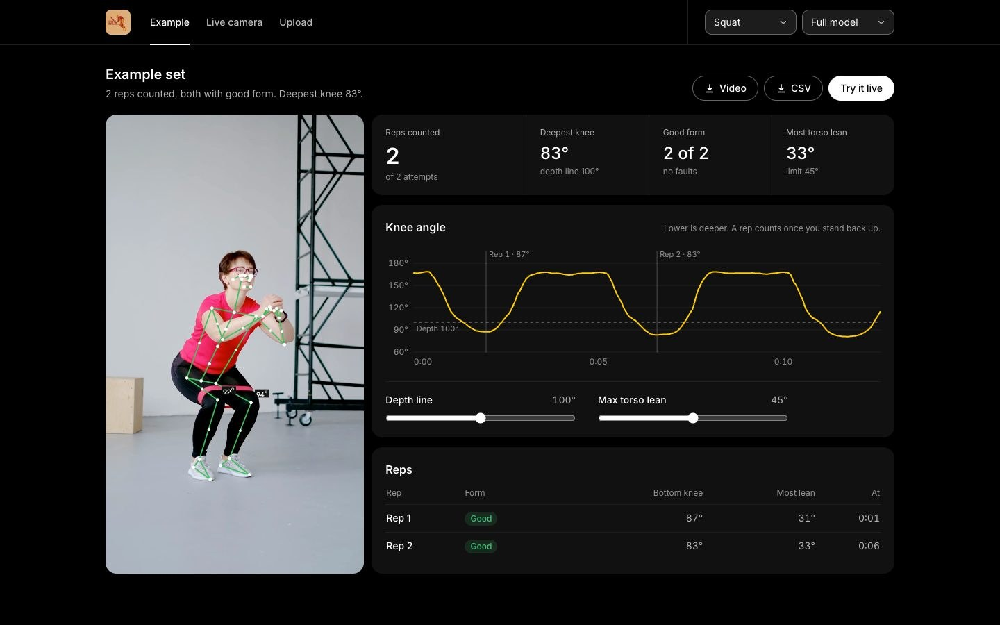

# USC Pre-PT Club movement analysis

A local web app that analyzes squat and physical therapy videos with pose estimation. It counts reps, measures knee angle and torso lean, and flags form faults such as leaning too far forward, knees caving in, and not going deep enough. Video is processed on your own computer and never uploaded anywhere.



## Features

- **Example:** a sample squat, analyzed in advance. The counters, chart and rep table follow the video as it plays.
- **Live camera:** analyzes the built-in camera in real time, with a live knee-angle trace.
- **Upload:** analyze a video from your phone, then download the annotated video and the per-frame data as CSV.
- **Adjustable thresholds:** set the depth line and the maximum torso lean, then re-analyze.
- **Two exercises:** squats (reps and form) and elbow angles.
- **Command line:** `main.py` does the same analysis without the web app.

## Set up

Requires Python 3.12.

```bash
python3.12 -m venv .venv
.venv/bin/pip install -r requirements.txt
mkdir -p models
curl -L -o models/pose_landmarker_full.task https://storage.googleapis.com/mediapipe-models/pose_landmarker/pose_landmarker_full/float16/latest/pose_landmarker_full.task
curl -L -o models/pose_landmarker_heavy.task https://storage.googleapis.com/mediapipe-models/pose_landmarker/pose_landmarker_heavy/float16/latest/pose_landmarker_heavy.task
```

## Run

```bash
.venv/bin/python app.py
```

Open http://127.0.0.1:5055. The first start analyzes the example clip, which takes a few seconds.

- **Live mode** needs camera access for the app that started the server (macOS: System Settings, Privacy & Security, Camera).
- **Testing without a camera:** `app.py --camera path/to/video.mp4` loops a video file as a stand-in camera.
- **Command line:** `.venv/bin/python main.py video.mp4 -o out.mp4 --exercise squat`

The server listens on 127.0.0.1 only, so it is not reachable from other computers.

## Host it online

The app also runs on a server, with the Example and Upload tabs only. The live camera is switched off there, because a server's camera is not the visitor's and the video would leave their device. Uploaded videos are deleted after an hour, and uploads are capped at 200 MB.

The `Dockerfile` builds that version and works on any host that runs containers (Hugging Face Spaces, Render, Fly.io and similar):

```bash
docker build -t pose-analyzer .
docker run -p 7860:7860 pose-analyzer
```

It sets `HOSTED=1`, downloads the pose models during the build, and listens on `$PORT` (7860 by default). The app keeps upload jobs in memory, so run a single instance. It is not suited to serverless platforms such as Vercel: the dependencies are too large, uploads and analysis take too long, and there is no camera.

## How reps are judged

| Check | Default |
| --- | --- |
| A rep starts when the knee angle drops below | 150° |
| A rep ends when the knee angle rises above | 155° |
| A rep counts if the knee reaches | 100° or less |
| Shallower attempts down to 140° are flagged | "Too shallow" |
| Torso lean from vertical flagged above | 45° |
| Knees caving in (knee gap / ankle gap) flagged below | 0.9, while the knee is bent past 130° |

A fault has to last 3 frames to show and 3 frames to clear. These are common defaults, not clinically validated, and the depth and lean limits can be changed in the app. This is a learning tool and is not medical advice.

Angles are measured from MediaPipe's 3D world landmarks, because 2D angles are badly distorted when a limb points at the camera. Landmarks are smoothed once with a One Euro filter.

## Project layout

```
app.py              web server (Flask)
main.py             command-line tool
pose/               analysis: pose estimation, angles, smoothing, squat logic, drawing
webapp/             the web UI: templates, static files, live camera and upload jobs
tests/              unit tests
tools/              make_test_video.py builds a synthetic test clip
samples/            the example squat clip
```

Run the tests with `.venv/bin/python -m unittest discover tests`.

## Credits

Pose estimation by [MediaPipe](https://ai.google.dev/edge/mediapipe) (BlazePose). `samples/squat_front.mp4` is [Pexels video 4838220](https://www.pexels.com/video/4838220/). The club logo belongs to the USC Pre-Physical Therapy Club.
